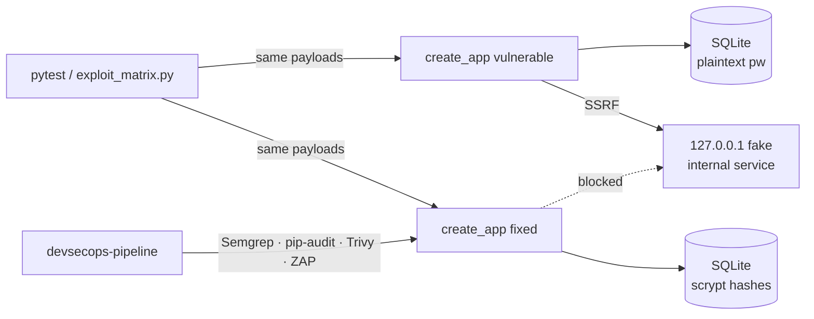

# owasp-vuln-vs-fixed

A small Flask app with two modes — **vulnerable** and **fixed** — that covers SQL injection, XSS (reflected + stored), CSRF, SSRF, IDOR and broken authentication. 43 tests prove each exploit works in vulnerable mode and is blocked in fixed mode. Part of a security-engineering portfolio; the [`devsecops-pipeline`](https://github.com/braylo-ai/devsecops-pipeline) repo scans this app with SAST, SCA, container and DAST tools.

> **Local use only.** Vulnerable mode is unsafe by design. It binds to `127.0.0.1` by default. Never expose it to a network.

## What it is
One codebase, one `create_app(mode)` factory. Every route keeps the vulnerable line and the fixed line next to each other, so a diff of the two branches of an `if fixed:` is the whole lesson.

| OWASP 2021 | Route | Vulnerable | Fixed |
|---|---|---|---|
| A03 Injection (SQLi) | `GET /search?q=` | f-string SQL, DB error echoed | parameterised query |
| A03 Injection (XSS, reflected) | `GET /greet?name=` | `Markup(f"...{name}")` | `Markup("...{}").format(name)` + CSP |
| A03 Injection (XSS, stored) | `GET/POST /comments` | raw HTML joined into page | escaped + CSRF token |
| A01 Broken access control (CSRF) | `POST /transfer` | no token, `SameSite` unset | per-session token, `SameSite=Strict`, amount checks |
| A01 Broken access control (IDOR) | `GET /api/invoices/<id>` | lookup by id only | `WHERE id=? AND owner_id=?`, 404 on miss |
| A10 SSRF | `GET /fetch?url=` | fetches anything, incl. `file://` | http/https only, resolve + block private/loopback/link-local, no redirects |
| A07 Auth failures | `POST /login`, `GET /me` | plaintext passwords, user enumeration, no lockout, `md5(username)` remember-me cookie, `SECRET_KEY="dev"` | hashed passwords, one generic error, 5-try lockout, session rotation, random key |
| A05 Misconfiguration | all | no security headers, `HttpOnly` off | CSP, `nosniff`, `X-Frame-Options`, COOP/CORP, `no-store` |

## Why
Most OWASP demos only show the attack. Hiring managers and auditors want to see the fix **and** proof the fix holds. Here every exploit is a test, and every test runs against both modes.

## Architecture


## How it works
- `vulnapp/app.py` — the app. `fixed = mode == "fixed"` switches each control.
- `is_safe_url()` — SSRF guard. Resolves the host and rejects any internal address, so decimal (`2130706433`), IPv6 (`[::1]`) and `localhost` tricks fail.
- `tests/test_owasp.py` — 43 tests. Payloads hit the Flask test client; the SSRF target is a throwaway `http.server` on `127.0.0.1`.
- `scripts/exploit_matrix.py` — runs 9 headline exploits against both modes and writes `results/exploit-matrix.{json,md}`.

Demo users (fake, seed data only): `alice / alice-pass-123`, `bob / bob-pass-456`, `admin / Adm1n-demo-only!`.

## Results
Measured 2026-11-07 on macOS, Python 3.12.4. Raw output: [`results/exploit-matrix.md`](results/exploit-matrix.md), [`results/pytest-summary.txt`](results/pytest-summary.txt).

| Exploit | vulnerable | fixed |
|---|---|---|
| A03 SQL injection (tautology) | EXPLOITED | BLOCKED |
| A03 Reflected XSS | EXPLOITED | BLOCKED |
| A03 Stored XSS | EXPLOITED | BLOCKED |
| A01 CSRF fund transfer | EXPLOITED | BLOCKED |
| A10 SSRF to internal service | EXPLOITED | BLOCKED |
| A01 IDOR read other user's invoice | EXPLOITED | BLOCKED |
| A07 Username enumeration | EXPLOITED | BLOCKED |
| A07 Brute force (no lockout) | EXPLOITED | BLOCKED |
| A07 Forged remember-me cookie | EXPLOITED | BLOCKED |

**vulnerable: 9/9 exploited · fixed: 9/9 blocked.** Test suite: **43 passed**.

## Run it
```bash
python3 -m venv .venv && .venv/bin/pip install -r requirements-dev.txt
.venv/bin/pytest -q
.venv/bin/python scripts/exploit_matrix.py
APP_MODE=vulnerable .venv/bin/python -m vulnapp.app   # http://127.0.0.1:5000
```

## Limits / scope
- Teaching app. The fixes are correct for these routes, not a full framework (no ORM, no real user signup, lockout state is in-process memory).
- The lockout keys on username only; a real system also needs per-IP and global rate limits plus a CAPTCHA or step-up path.
- SSRF guard checks DNS at validation time; a production guard must also pin the resolved IP for the request to stop DNS rebinding.
- `SESSION_COOKIE_SECURE` is off by default so the app works over plain `http://127.0.0.1`; set `COOKIE_SECURE=1` behind TLS.
- No real targets. Every test and script talks to the in-process app or `127.0.0.1`.

## License
MIT
